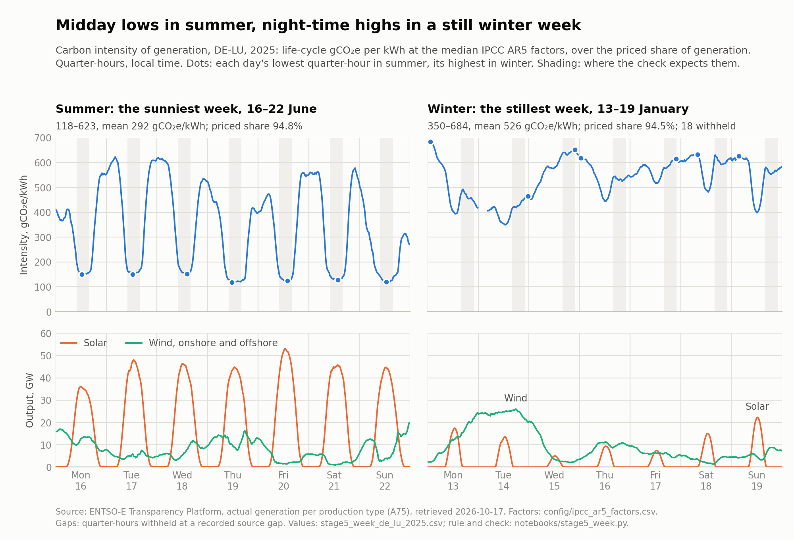

# Grid Carbon Intensity

Hourly-and-quarter-hourly carbon intensity for two European bidding zones,
DE-LU and FR, **derived** from the ENTSO-E generation mix using published
life-cycle factors — IPCC AR5 for most fuels, a country-resolved inventory for
German lignite and hard coal — rather than consumed from a vendor, with the
published factor uncertainty propagated through to a 90% interval by Monte
Carlo, and a first-order sensitivity index saying which fuel's factor that
interval is mostly made of.

The eventual purpose is a load-shifting decision model that prices the saving
in tCO2e and euros. That is the question the project exists to answer; it is
not built yet. See **What is not built** below.

> **Status: in build (started 7 August 2026).** See `RUNBOOK.md` for the staged
> plan and current position. Nothing in this repository is presented as
> operational until Stage 10 passes.

## Hypothesis

*Recorded on 10 October 2026 in commit `e0102a0`, before any generation data
was pulled. At that commit `raw/manifest.csv` listed day-ahead prices (A44) and
SMARD rows only — no A75 generation for either zone. The first A75 pulls
followed on 17 October 2026, so no result existed that this could have been
fitted to. The commit timestamps are the record.*

The zone comparison tests a hypothesis rather than asserting one. France's
generation mix barely changes across the day; Germany's (DE-LU) changes a great
deal. For the same plant shifting the same load within the day, therefore:

- the **CO₂ saving should differ sharply between the zones** — larger in DE-LU,
  where the mix moves, than in FR, where it barely does;
- the **cost saving should exist in both**.

Whether that holds is for the data to say. Each saving will be reported per
zone with its Monte Carlo interval. One limitation is stated with it from the
start: the intensity used here is the *average* intensity of the generation
mix, not the *marginal* intensity of the plant that actually responds to a
shift, and the two can differ substantially.

## Stack

Open-access end to end, by design. Python ingestion → immutable raw layer with a
SHA-256 manifest → Parquet → **DuckDB** warehouse → **dbt** (sources, staging,
intermediate, marts, tests, lineage), with **GitHub Actions** for CI and a
**Quarto** report to follow. Uncertainty propagation and the sensitivity shares
are plain Python — NumPy, no modelling framework — in
`src/transform/intensity.py`.

What has run on real data and what has run only on test fixtures is kept
apart throughout. The ingestion clients, both parsers, the uncertainty module
and CI are written and unit-tested. Of the live sources, ENTSO-E day-ahead
prices (A44) for DE-LU 2025 and one SMARD week were pulled on 6 October 2026,
generation per type (A75) for DE-LU and FR, 2025 on 17 October 2026 and
2021–2024 on 18 October, the remaining prices for both zones, 2021–2025, on
18 October, and every SMARD price week of 2021–2025 on 19 October; load (A65)
has not been fetched. The A75 parser and the stage 2–5 checks have
run on all ten zone-years, stage 5 on the median-factor intensity. Landed, the
2021–2025 A75 and A44 data build green through the dbt project,
23 nodes on 18 October 2026 and again on 19 October with the new coal rows,
and CI builds every model on fixtures and checks
it against the Python parser. The
fact tables, the Monte Carlo interval on real data and the report are not
built. **What is not built** has the detail.

The acceptance criterion that governs the whole build: **the deterministic
point estimate must fall inside the sampled 90% interval.** The deterministic
point is `deterministic_intensity()` — the energy-weighted mean at each fuel's
median factor, no sampling — and it is a different quantity from the median of
the draws. If it escapes the interval the propagation is skewed, and no figure
is published.

> Corrected 7 October 2026. The test behind this criterion used to compare the
> sampled median against the sampled percentiles, which is true by definition
> and could never fail. The headline control was vacuous for seven weeks.
>
> Corrected 17 October 2026. Once the test was real, it held for coal- and
> gas-heavy mixes and failed for nuclear-heavy French ones, because the sampler
> moved the median of every skewed factor band. The sampler now keeps each
> published median, and the criterion holds on all of 729 French-like test
> mixes (see **The interval is the deliverable**).

## What is not built

Named here rather than left for a reader to discover.

| | Status |
|---|---|
| dbt facts | **not built.** Staging, the three intermediate models and the three dimensions stand: built green on the 2021–2025 A75 and A44 data on 18.10.2026, and on fixtures in CI. `stg_entsoe__load` and `stg_entsoe__flows` are disabled until A65 and A11 are pulled. (Corrected 08.10.2026: an earlier version of this row said no models were written; the 10 models arrived on 5 October in commit `1c21970`.) |
| `curated/sample/` | **absent.** From a clean clone, `dbt build` has no data to read; `pytest src/transform/test_dbt_models.py` builds the models on fixtures instead |
| Load-shifting decision model | **not started** — the question the project exists to answer |
| Quarto report, GitHub Pages | **not started** |
| Power BI dashboard | **not started**; it will read the exported Parquet. The Azure portability excursion was dropped in October 2026 and is archived in `archive/azure-excursion/` |
| Sobol sensitivity of the saving | **not built**. For the intensity alone, `variance_contribution()` reports first-order variance shares — for this linear model, its first-order Sobol indices — and each fuel's share of the 90% interval width |
| Cross-border flow (A11) import adjustment | **not built**; intensity is average, not marginal |
| Trap 5, the two competing A44 price curves | **handled** 08.10.2026 — `entsoe_prices_parse.py`, `xml_to_parquet.py` and the curve filter in `stg_entsoe__prices.sql`. DE-LU carries both curves in every year from 2021, France one; the filter keeps every delivery period (18.10.2026). Which curve is the market's was settled on 19.10.2026: curve 1, the default, which equals SMARD filter 4169 to the cent at every hour and quarter-hour of 2021–2025 |

What *is* built: ingestion with a redacting manifest, run for A44 and SMARD;
the A75 parser with its four traps, tested on fixtures including both
daylight-saving transition days and run on the real 2021–2025 pulls for DE-LU
and FR; the A44 price parser with the fifth, run on the real 2021–2025 payloads for both zones; the raw
parquet landing, with both domains and the source digest on every row; the dbt
staging, intermediate and dimension models, checked against the Python parser;
Monte Carlo uncertainty with the sensitivity shares; the stage checkpoints,
each with a test that makes it fail; and CI across Python 3.11 and 3.14.

`config/zones.csv` carries five zones and marks the two the analysis covers.
The other three are configuration kept for the third-zone diagnostic, not
results: their pulls stay in `raw/`, `xml_to_parquet` lands only the two
analysis zones, and `notebooks/third_zone.py` measures all five from the raw
payloads. On 19 October 2026 the diagnostic chose PL: as flat within the day as
France at almost twice Germany's carbon level (`docs/THIRD_ZONE.md`). Choosing
it does not add it to the analysis yet.

No subscription, no licence and no free tier is required to run any of it.
`git clone` then `pytest` works today, and it builds the dbt models on
fixtures. `dbt build` on real data needs the payloads, which are not
redistributed (see **Licence**): pull and land them with a token, or wait for
`curated/sample/`, which is planned. Stated here rather than discovered after
cloning.

The architecture is defined in [`docs/ARCHITECTURE.md`](docs/ARCHITECTURE.md).

## Data provenance

| Source | Used for | Access |
|---|---|---|
| ENTSO-E Transparency Platform | Generation per production type (A75), day-ahead prices (A44), actual load (A65) | REST API, token |
| SMARD (Bundesnetzagentur) | Independent second source. Filter 4169, the day-ahead price, settled trap 5 for 2021–2025 and is pinned by six tests; a reconciliation of generation in dbt is planned, not written | REST, no key |
| IPCC AR5 WG3 Annex III | Lifecycle emission factors with published ranges, for every priced fuel but lignite and hard coal | `config/ipcc_ar5_factors.csv` |
| Itten et al. (2023), ZHAW, for the Swiss UVEK life-cycle inventory database | Lignite and hard coal (B02, B05): Germany's values read off Fig. 4.5, the ranges across countries as bands | `config/ipcc_ar5_factors.csv` |

A fetcher exists for each ENTSO-E and SMARD row above. The A44 and SMARD
fetchers ran on 6 October 2026, the A75 fetcher on 17 October 2026 (DE-LU and
FR, 2025), and SMARD again on 19 October for every week of 2021–2025; A65 has
not run. Each yearly request covers the zone's local
calendar year, so consecutive years meet at local midnight. Cross-border
flows (A11), DWD temperature and EEA verified emissions are candidates for
later work and have no fetcher, so they are not listed as sources.

All grid, price and factor data are real and cited. Any facility load profile
used later in the decision model will be **illustrative and labelled as such**.

### What the manifest hash does and does not tell you

`raw/manifest.csv` records a sha256 for every payload. That hash identifies the
**retrieval**, not the data. ENTSO-E stamps each response with a fresh `mRID` and
a `createdDateTime`, so the same query repeated minutes later returns a different
hash. Measured on two pulls of the identical 2025 DE-LU A44 query:

| Retrieved (UTC) | Bytes | sha256 | `mRID` |
| --- | --- | --- | --- |
| 2026-10-06 16:30:47 | 7,544,161 | `d9687790…` | `a87148b1…` |
| 2026-10-06 18:31:50 | 7,544,161 | `9d48b590…` | `1c85b890…` |

Same byte count, same 732 TimeSeries, same 50,044 points, different hash. The
size is unchanged because both differing fields are fixed-width.

Only the second of those two payloads still exists: the second pull overwrote
the first. Since 10 October 2026 that cannot happen. `raw/` is append-only
(`src/ingest/raw_store.py`): every retrieval is a new file named by its
retrieval time and hash, a response that is not data — a non-200 status, an
Acknowledgement, a body that does not parse — goes to a `_failed/` folder, and
the manifest records each document's `revisionNumber`.

The consequence: **a changed manifest hash does not mean the data changed.** It
changes on every fetch. Comparing hashes to answer "has ENTSO-E revised this
series since we pulled it?" returns a false positive every time.

The field that does answer that question is `revisionNumber` in the
`Publication_MarketDocument` — 1 in both pulls above. For a content-level check
independent of the envelope, hash the extracted
`(resolution, classificationSequence, timestamp, value)` tuples instead of the
raw file: that is stable across retrievals and moves only when the numbers do.

The file hash is still worth recording. It answers a different and narrower
question — whether the bytes on this disk are the bytes that arrived — which is
what a provenance record is for.

### Missing data in the generation pulls, 2021–2025

The A75 pulls of 17 and 18 October 2026 are not complete, and the coverage
check says so rather than smoothing it over (`check_stage3_coverage` in
`src/checks/validate.py`, with `assert_step_count_per_local_day` as its SQL
twin):

- **Two counting rules.** A step counts if either leg reports it: RTE's hourly
  data, until 18 December 2024, states pumped storage, reservoir hydro and
  coal net, one leg per hour, so a pumping hour has no generation row, and
  wind farms drawing auxiliary power report a consumption leg only. And
  coverage is measured in time, not by counting rows: France moved from hourly
  to quarter-hour data on 19 December 2024, and that day has one hourly row and
  92 quarter-hours.
- **Declared exemptions,** in `config/sparse_series.csv`. France's hard coal
  (B05) and battery storage (B25) are published only while units run: coal is
  absent on 307 days of 2025, with a median of 524 MW when present, so a
  missing quarter-hour is zero output. Three series are exempt inside a window
  only: German nuclear (B14) from 16 April 2023, after the last reactors left
  the grid; German coal-derived gas (B03) before 2023 and French offshore wind
  (B18) before June 2023, when neither series existed yet.
- **Every other gap is a recorded source gap,** listed with its size in
  `config/source_gaps.csv`, 101 entries. DE-LU: 3 in 2024 (10 quarter-hours)
  and 11 in 2025 (37, one quarter-hour on 9 July across seven fuels, the rest
  in hydro reservoir and waste). France: one publication outage in 2022 (an
  hour across ten series), three in 2023 plus the patchy first weeks of
  offshore wind (55 entries, 454 hours), and two outages in 2025 (22 entries,
  209 quarter-hours). 2021 is complete in both zones. Gaps are not filled in:
  a step that is missing a fuel is withheld when the intensity is computed.
- The check fails on any gap that is neither declared nor recorded, including a
  recorded one whose size changes in a later pull.
- **One anomaly, listed rather than corrected.** On 18 April 2025, 14:15–17:15
  local, RTE reports French onshore wind (B19) as consumption, 12 quarter-hours
  at about 970 MW, and no generation leg: almost certainly generation filed
  under the wrong direction. Those quarter-hours count as covered and carry no
  onshore wind, so their intensity is overstated.

*Corrected 18 October 2026: the 2025 register listed 58 French gaps,
531 quarter-hours. 36 of them, 322 quarter-hours mostly in offshore wind, carry
a consumption leg instead: generation in them was zero, not missing, except in
the anomaly above.*

Battery storage (B25) is unpriced, like pumped storage (B10): its emissions
belong to whatever charged it. Oil (B06) is unpriced as well until a factor is
cited: AR5 has no oil row, and the earlier value was a placeholder. Lignite
(B02) is no longer priced from AR5's single coal row (740–910): life-cycle
studies put lignite at 900–1,300 gCO₂e/kWh (Turconi et al., 2013), and on the
coal row DE-LU was understated by 38–52 gCO₂e/kWh, 2021–2025. No lignite
source publishes a median, so since 19 October 2026 B02 carries Germany's own
value from a country-resolved life-cycle inventory, 1,060 gCO₂e/kWh read off
Itten et al. (2023, Fig. 4.5), with that study's 1,000–1,350 range across
countries as the band. Hard coal (B05) followed the same day: the same figure
puts German hard coal at 1,040 gCO₂e/kWh, above the whole coal row, so B05
carries that value, with the study's 861–1,320 range across countries as its
band; on the coal row DE-LU had been understated by a further 14–29
gCO₂e/kWh, and France, where hard coal is 0.1–0.8% of generation, by up to
1.8. Biomass (B01) uses AR5's row for dedicated
energy crops and crop residues, narrower than Germany's category: two thirds
of Germany's biomass electricity outside waste plants is biogas. Weighting the
Umweltbundesamt's pathway factors by Germany's 2021–2025 biomass mix gives
222–276 gCO₂e/kWh, inside the row's 130–420, and moves DE-LU by −0.7 to +4.0,
so the row stays. Coal-derived gas (B03) borrows the coal row at about 1% of
DE-LU generation, and solar (B16) uses AR5's utility-PV row rather than
rooftop, which would move DE-LU by at most 1.2 gCO₂e/kWh. The numbers
are in `docs/FACTOR_CHECK.md` (decided 18 and 19 October 2026).

**Every intensity figure carries its priced share.** Unpriced fuels are left out
of both sides of the ratio, so an intensity describes the priced part of
generation only: 94.9–95.6% of it in DE-LU and 97.7–98.5% in France, 2021–2025.
The runbook's bar is 98% for DE-LU, and storage, waste, oil and the undisclosed
categories keep it out of reach. Rather than price them without a cited
source, the share is stated beside every intensity figure this repository
publishes (decided 18 October 2026).

## What is non-obvious in this data

Five things in the real ENTSO-E payload that a naive parser gets wrong. Traps 1
to 4 are handled in `src/transform/entsoe_parse.py` and asserted in
`test_parse.py`. Trap 5 was found on 6 October 2026 in the first full-year pull
and is handled as of 8 October 2026 in `src/transform/entsoe_prices_parse.py`,
asserted in `test_prices_parse.py`, and enforced in SQL by the curve filter in
`stg_entsoe__prices.sql` plus two singular dbt tests.

1. **`curveType` A03 omits repeated values.** One DE-LU series states 5 points
   for a 96-step day; the other 91 must be carried forward. A naive loop loses
   95% of that day with no error raised.
2. **`outBiddingZone_Domain` is consumption.** Pumped storage appears twice in
   the same document — once generating, once pumping. Summing both inflates the
   mix and corrupts the intensity denominator.
3. **DE-LU publishes at PT15M.** 96 steps per day, so daylight-saving days have
   **92 and 100** steps, not 23 and 25.
4. **The unit is MAW — power, not energy.** MWh = MW × step_hours, which matters
   as soon as zones at different resolutions are combined.
5. **A44 returns two competing price curves for DE-LU, and only one field tells
   them apart.** The full-year 2025 DE-LU day-ahead pull is 50,044 points — more than
   a year holds at PT15M (35,040). The document carries 732 TimeSeries that are
   identical in `businessType` (A62), `contract_MarketAgreement.type` (A01),
   `auction.type` (A01), domain, currency and unit. The *only* discriminator is
   `classificationSequence_AttributeInstanceComponent.position`:

   | position | resolution | coverage | points | median €/MWh |
   | --- | --- | --- | --- | --- |
   | 1 | PT60M | 2024-12-31 23:00 → 2025-09-30 21:00 | 6,514 | 94.50 |
   | 1 | PT15M | 2025-09-30 22:00 → 2026-01-01 22:15 | 8,853 | 89.67 |
   | 2 | PT15M | 2024-12-31 23:00 → 2026-01-01 22:00 | 34,677 | 92.41 |

   Position 1 is one continuous series that switches resolution at the German
   15-minute MTU go-live, 1 October 2025 local. Position 2 runs at PT15M for the
   whole year. Where they overlap — 8,605 timestamps in Q4 — they **disagree in
   8,602 of them**: median difference +0.41 €/MWh, but the range runs from
   −198.37 to +278.69. The divergence is largest in exactly the scarcity and
   negative-price quarter-hours a load-shift study is about.

   The earlier years, pulled on 18 October 2026, carry the same pair: in
   2021–2024 position 1 runs at PT60M and position 2 at PT15M, every year, so a
   15-minute curve exists from January 2021 at the latest, nearly five years
   before the 15-minute MTU went live. That was further evidence, though not
   proof, that position 2 is not the binding day-ahead result; SMARD has since
   settled it (below). France publishes one
   curve, hourly until delivery day 29 September 2025 and PT15M from 30
   September, a day before DE-LU; on that first day it states one price per
   hour, so its first 15-minute day still carries hourly prices.

   Key on `(resolution, classificationSequence…position, timestamp)`, never on
   timestamp alone. A parser that groups by timestamp silently turns the choice
   of curve into whatever `first()`, `mean()` or `last()` happens to do.

   Two corollaries of trap 1 measured on the same file: the PT60M series declares
   6,551 hours in its `timeInterval` (6,552 minus the 23-hour DST day on
   30 March) and delivers 6,514 — **37 points dropped by A03 compression** that
   must be carried forward. And the hourly price never equals its four
   quarter-hours: 0 agreements in 6,323 comparable hours. They are separate
   market products, not an aggregation.

   **How it is handled.** `classification_sequence` is emitted by the parser,
   carried through `raw/parquet/a44.parquet`, and filtered once in
   `stg_entsoe__prices.sql` under the dbt var `a44_curve`, default 1. Curve 1
   was chosen on 8 October for continuity, as the series that was binding at
   each moment, hourly until the 15-minute MTU go-live and 15-minute after,
   before anything showed it to be the market's.

   **On 19 October 2026 SMARD showed it.** Filter 4169, the
   Bundesnetzagentur's day-ahead price, was pulled for every week of 2025 and
   set against both curves by `notebooks/price_curves.py`, under a rule
   committed a minute before the first request. Curve 1 equals SMARD to the
   cent at all 6,551 hours before the go-live and at all 8,836 quarter-hours
   after it, its 93 carried-forward A03 steps included. Curve 2 agrees at
   0.23% and 0.03% of them, off by 7.9 and 11.7 €/MWh on average and by up to
   329. SMARD's own quarter-hour series repeats curve 1's hourly price before
   the go-live, and its hours average curve 1's quarter-hours after it. Two
   tests that need `raw/` pin the verdict (`test_smard_parse.py`).

   Curve 2's limits fit EXAA, which runs a separate quarter-hour auction for
   Germany at 10:15 and whose price range was −150 to +3,000 €/MWh
   ([Wikipedia](https://en.wikipedia.org/wiki/Energy_Exchange_Austria)).
   Curve 2's floor is −149.99 €/MWh in 2021–2023, it peaks at 2,999.99 in
   2022, and from 2024 its floor is −499.99. That identification is
   circumstantial, and nothing depends on it.

   **2021–2024, pulled the same evening, agree as well.** Those years had
   hourly MTU throughout. Curve 1 equals SMARD to the cent at every hour:
   8,760 in each of 2021–2023 and 8,784 in 2024. The means of curve 2's
   quarter-hours come within a cent at 0.10–0.29% of them. Across the five
   years that is 50,451 steps of curve 1, its 241 carried-forward ones
   included, without a single difference. SMARD's quarter-hour series repeats
   curve 1's hourly price in every year before the go-live. The same rule
   applies to each year, with only its first regime, and four more tests pin
   it.

   The arithmetic of ignoring the discriminator, measured: unfiltered, the
   50,044 points carry 15,014 duplicated `(zone, period, position)` keys and a
   median of **91.80 €/MWh** — a figure that belongs to neither curve (90.80
   and 92.41). `dbt/tests/assert_one_price_per_zone_timestamp.sql` fails if a
   timestamp ever appears twice again, and
   `dbt/tests/assert_every_price_period_survives_the_curve_filter.sql` catches
   the opposite mistake: a curve setting that silently deletes delivery periods.
   Curves are counted per zone *and* delivery period, so a zone that publishes
   one curve in one year and two in the next keeps both years.

   One limit worth stating: the staging model carries **stated points only**,
   as the raw layer is meant to. A03 compression means curve 1 is missing 116
   of 15,483 steps (0.75%) and curve 2 is missing 459 of 35,136 (1.31%). The
   carry-forward belongs in an `int_` model that does not exist yet, so a join
   on `ts_utc` today silently drops those intervals.

## Two weeks of DE-LU, looked at



The deterministic intensity at median factors, for two weeks of 2025 chosen by
a rule fixed before anything was plotted: the sunniest week of June–August and
the stillest of December–February (`notebooks/stage5_week.py`; every value
drawn is in `docs/figures/stage5_week_de_lu_2025.csv`). In summer the
intensity falls from about 500 gCO₂e/kWh at night to 118–152 at midday, every
day, and solar output peaks at 12:45; a misread timestamp, or a fuel joined to
the wrong factor, would move or invert that dip. The still winter week runs
highest at night, not in the evening as the runbook expected: lignite and hard
coal hold at about 16 GW at every hour, while the evening adds gas and wind,
both below the mix's average. The two weeks' intensities rest on 94.8% and
94.5% of their generation, the priced share.

## Against Electricity Maps

Electricity Maps puts Germany's 2025 intensity at 335.4 gCO₂eq/kWh, imports
included; ours is 352.1, energy-weighted over the priced share. Their hourly
series is not open to a public repository, so `notebooks/em_crosscheck.py` uses
what is: their open-source factors for Germany and their published figures,
under a rule committed before the run. **The timing agrees**: their lowest and
highest hours of 2024 and 2025 rank between 1st and 21st of about 8,750 in
ours, and their days between 1st and 5th. **The level is not settled**: with
their factors and coverage, our parse lands 0.4% above their production-based
2025 mean if that mean is energy-weighted and 4.8% if it is a plain mean of
hours, and their page does not say which. The gap from 352.1 to 335.4 is their
factors (+9.8, mostly coal), the generation we leave unpriced (+2.2), a
residual (−1.5) and imports (−27.1); both sides use life-cycle factors.
Details, and 2024, in `docs/EM_CROSSCHECK.md`.

## The interval is the deliverable

A carbon intensity quoted as a single number is a number nobody can audit.
AR5 publishes a *range* per fuel, so `src/transform/intensity.py` samples each
factor and reports the median with a 90% interval, the share of the hour's
energy that carried a factor at all, and how much of the interval each fuel's
factor accounts for.

One methodological decision worth stating plainly, because it decides whether
low-carbon hours come out right. AR5 gives three numbers per fuel — min,
median, max — and most bands reach much further above the median than below
it: nuclear 3.7 / 12 / 110, hydropower 1 / 24 / 2200 gCO₂e/kWh. Each factor is
sampled from a **two-piece lognormal**: the published median is its median, the
published min and max sit at its 2.5th and 97.5th percentiles, each side of
the median takes its own spread, and every draw stays inside the published
band. `describe_sampling()` lists the fitted spreads per fuel.

One band is narrower than AR5's, decided 18 October 2026. AR5 has a single
hydropower row, and its upper end is reservoir methane, which a run-of-river
plant has no reservoir to emit. Run-of-river (B11) therefore keeps AR5's
minimum and median and stops at the median, 1 / 24 / 24; reservoirs (B12)
keep the full row. Under the full band, run-of-river accounted for 65–71% of
France's interval variance in 2021–2025 at 7–9% of its generation. The point
estimate does not change; France's interval narrows by 35–40%.

Two factors are not AR5's, decided 19 October 2026. AR5's single coal row
stops at 910 gCO₂e/kWh, below where a life-cycle inventory resolved by country
puts Germany's lignite and hard-coal plants. Lignite (B02) and hard coal (B05)
therefore carry Germany's values from that inventory, 1,060 and 1,040, with
its ranges across countries as their bands, 1,000–1,350 and 861–1,320 (Itten
et al., 2023). Lignite's band reaches much further above its centre than
below, and lignite now leads DE-LU's interval with 48–57% of the variance,
2021–2025; hard coal has 13–31%.

> Changed 17 October 2026 (method 2.0.0). Until then the default was a
> triangular with the published median as its mode. For a skewed band that
> moves the median — nuclear's came out at 37.7 instead of 12 — so French,
> nuclear-heavy hours came out too dirty and their deterministic point fell
> outside its own interval. Hydro already had a lognormal, but with an open
> upper tail that ran past AR5's maximum. A triangular over the hydro range
> would put the median near 650 gCO₂e/kWh, dirtier than gas.

The sensitivity shares reuse one set of draws for every fuel (common random
numbers), so they cannot depend on the order in which a mix is written down;
until 17 October they did. Intensity is linear in independent factors, so the
variance shares are first-order Sobol indices and sum to one, up to Monte
Carlo error. The
interval-width shares are reported beside them because a heavy tail can lead
the variance without leading the interval: in a nuclear-heavy test mix, hydro
supplies 3% of the energy, 23% of the variance and 13% of the interval width.

## Tests

`pytest` — 186 tests, all green: 157 test functions, some parametrised. Ten
read real payloads in `raw/`: four the 7.5 MB 2025 A44 file, six the A44 files
of 2021–2025 with the SMARD weeks. They **skip in CI**, because `raw/*` is
gitignored. Seven build the dbt models with dbt-duckdb and run in CI's dbt job
only; the unit-test job reports 169 passed, 10 skipped. A local run with `raw/`
populated reports 186 passed.

Runs on **Python 3.11 and later**. CI proves both ends of that claim —
3.11, the oldest version supported, and 3.14, the version it is developed
on — on every push and once a week. Its dbt job parses the project, which
resolves every model, source, `ref` and test without touching data, and then
builds every enabled model on landed fixtures and compares the result with
the Python parser step by step (`test_dbt_models.py`). Until 17 October 2026
CI only parsed, so no model had run there.

The checks rewritten on 17 October 2026 and the new dbt tests were also run
against mutants, copies of the code with one fix reverted: every mutant makes
at least one test fail.

| File | Tests | What they pin |
|---|---|---|
| `src/transform/test_parse.py` | 24 | Traps 1–4 in the A75 parser, on fixtures, including both transition days at PT15M and PT60M; A01 gaps left empty; an Acknowledgement or an empty document refused; the direction check against the XML |
| `src/transform/test_prices_parse.py` | 25 | Trap 5 and the A44 parser, including 4 transition-day cases and the 4 real-payload checks |
| `src/transform/test_dst.py` | 13 | Daylight-saving arithmetic of the validation calendar, `validate.expected_steps` |
| `src/transform/test_intensity.py` | 34 | The uncertainty propagation, the factor handling and the sensitivity shares |
| `src/checks/test_validate.py` | 27 | The stage checkpoints, including whole missing days, the coverage policy and the stage 5 recomputation |
| `src/ingest/test_entsoe_client.py` | 9 | Token redaction in exceptions and the manifest; yearly requests that cover the local year |
| `src/ingest/test_smard_client.py` | 5 | The SMARD backfill: the 53 weeks 2025 needs, a week ending at New Year left to the year before, both clock-change weeks, stored weeks not fetched again, failed ones fetched again |
| `src/transform/test_smard_parse.py` | 17 | SMARD weeks read strictly, six malformed shapes refused; the newest accepted retrieval of each week; hourly means of complete hours only; the agreement measure used against the two A44 curves; six real-data checks that curve 1 is SMARD's to the cent in every year 2021–2025 and curve 2 is not |
| `src/ingest/test_raw_store.py` | 12 | `raw/` is append-only: a failed pull never replaces data, every retrieval is kept, the smoke scripts report the status they actually got |
| `src/transform/test_xml_to_parquet.py` | 13 | The landing: stated points only, both domains, dtypes, provenance and the digest check, the newest accepted retrieval of each year, zones outside the analysis left in `raw/` |
| `src/transform/test_dbt_models.py` | 7 | The dbt models on landed fixtures, step by step against `parse()`; a deleted day and an empty A01 position fail their tests |

The test that matters most: **the deterministic point estimate must fall
inside the Monte Carlo interval built around it.** If it falls outside, the
propagation is wrong and every downstream figure is decoration. It is tested on
a coal- and gas-heavy mix, on two French mixes and on a sweep of 729 French-like
mixes. The sampler before 17 October 2026 failed 720 of those 729; the current
one fails none.

The A75 parser's daylight-saving arithmetic is tested on both 2026 transition
days, at PT15M (92 and 100 steps) and at PT60M (23 and 25). Hard-coding a
24-hour day now fails four tests, and computing energy with a fixed
quarter-hour fails four more.

> **Fixed 2026-09-17.** `validate.expected_steps` returned 24 hours for every
> day of the year, including both transition days. Python subtracts two aware
> datetimes that share a `tzinfo` object by ignoring the offset — "no time
> zone adjustments are done in this case" — so the DST branch was dead code
> that read as correct. It had no test. It does now.

## Layout

```
config/             zones, coverage exemptions, recorded source gaps and
                    emission factors: CSV, read by Python and dbt alike
src/ingest/         ENTSO-E and SMARD clients → raw/ + manifest.csv
src/transform/      A75 parser, A44 price parser, SMARD reader, parquet
                    landing, intensity, uncertainty
src/checks/         stage checkpoint functions, importable and testable
dbt/                10 models (8 enabled), 7 singular tests (1 disabled) and
                    9 generic ones; built on fixtures in CI and on the real
                    2025 data — see What is not built
docs/               ARCHITECTURE.md, the standard; RESOURCES.md, reading by stage;
                    FACTOR_CHECK.md and THIRD_ZONE.md, decisions with their
                    evidence; EM_CROSSCHECK.md, the comparison with Electricity
                    Maps; figures/, each PNG beside a CSV of what it draws
notebooks/          percent-cell exploration, nothing load-bearing: Stages 0–2
                    interactively, the third-zone diagnostic, the price-curve
                    check, the Stage 5 week plot, the Electricity Maps
                    cross-check
.github/workflows/  pipeline.yml — pytest on 3.11 and 3.14; dbt parse and a
                    build on fixtures; weekly
raw/                append-only landing, git-ignored: one folder per document,
                    zone and year, one file per retrieval, failures in
                    _failed/; manifest.csv is committed
raw/parquet/        stated points per document type, git-ignored, rebuilt with
                    `python -m src.transform.xml_to_parquet`
curated/            Parquet outputs, git-ignored
archive/            the dropped Azure excursion: its procedure and T-SQL,
                    kept for reference, run nowhere
conftest.py         makes `pytest` work from the repo root
requirements-figures.txt  figure libraries, not installed in CI

planned, not present yet — see RUNBOOK.md:
curated/sample/     bounded sample so `git clone && dbt build` runs tokenless
report/             Quarto source → GitHub Pages
docs/METHODOLOGY.md assurance write-up
```

## Licence / reuse

Three different things are licensed three different ways.

**The code is MIT** — see `LICENSE`. Use it, change it, ship it; keep the notice.

**The emission factors** in `config/ipcc_ar5_factors.csv` are reproduced with
citation from IPCC AR5 WG3 Annex III, except lignite and hard coal, which are
read off a figure in Itten et al. (2023); the file keeps its name. Verify
against the sources before relying on them.

**The ENTSO-E data is not redistributed here.** `raw/` is git-ignored and only
`manifest.csv` — the provenance record, with the token redacted — is committed.
Anyone re-running the ingestion obtains the data themselves, under the ENTSO-E
Transparency Platform's own terms of use, which this repository's licence does
not and cannot grant. The same will apply to `curated/sample/` once it exists:
a sample of ENTSO-E-derived values carries ENTSO-E's terms, not MIT.
